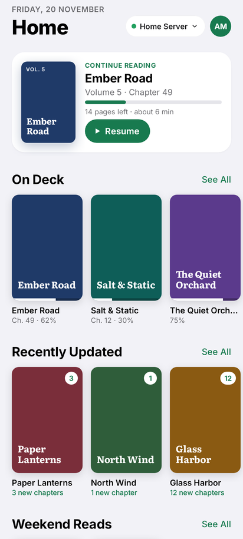
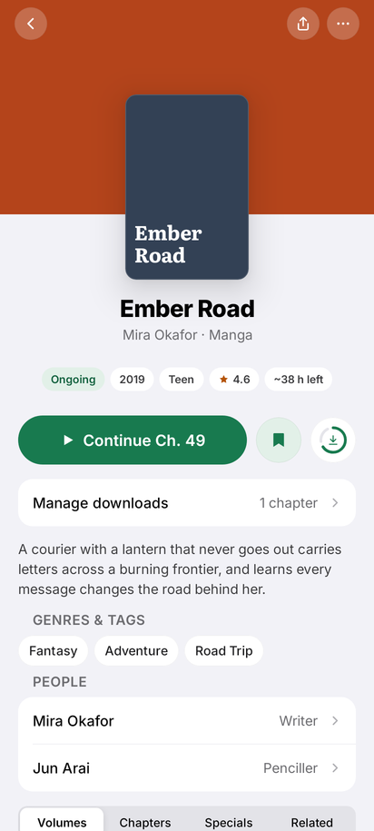
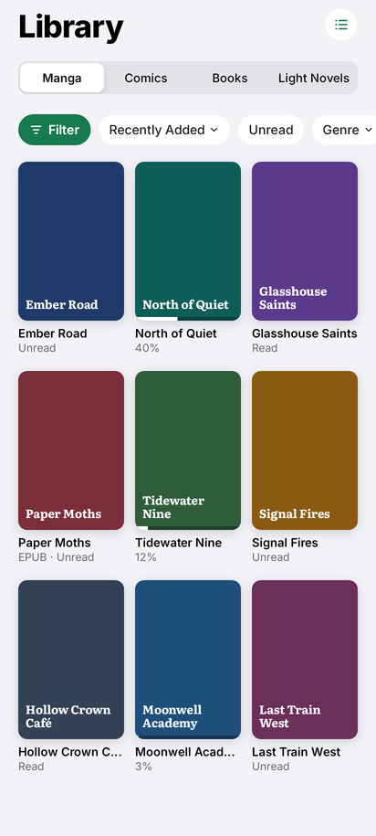
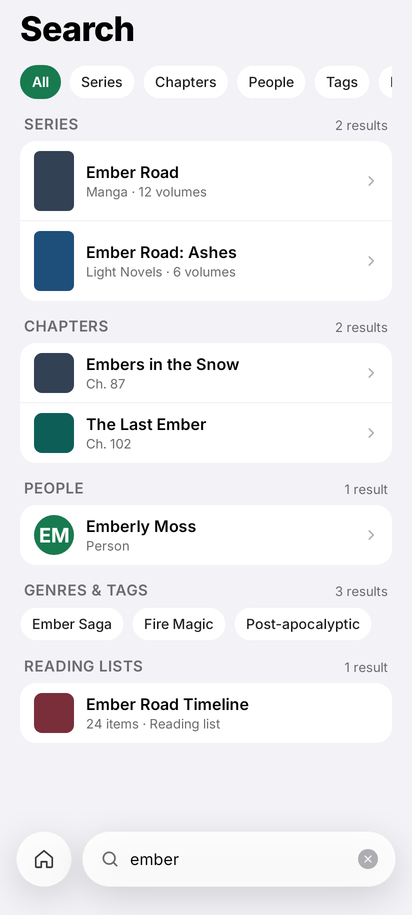
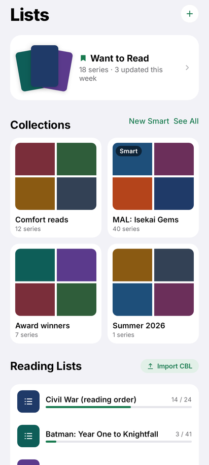
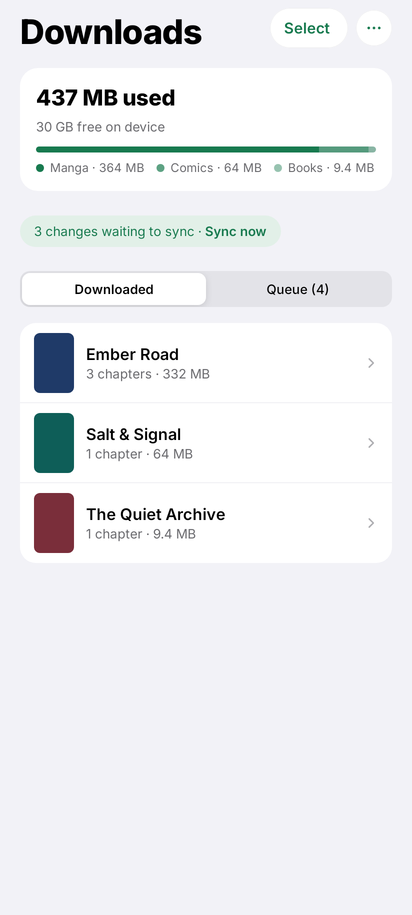
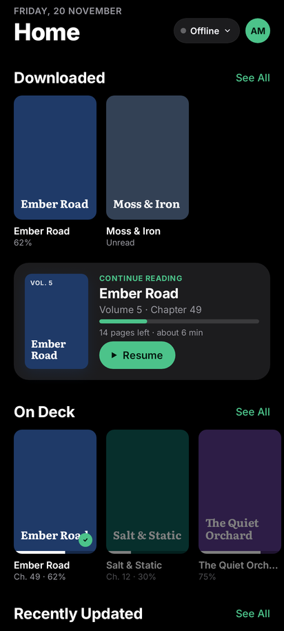
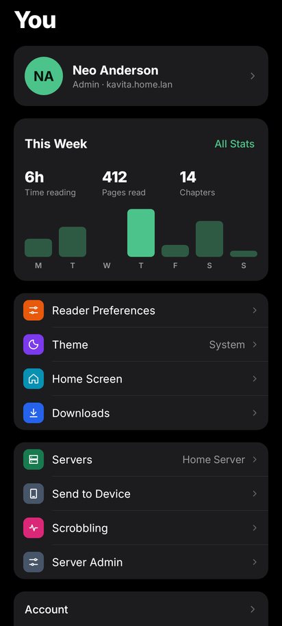

# Kaviyy

Kaviyy is an unofficial native Android client for [Kavita](https://github.com/Kareadita/Kavita), the self hosted
reading server for manga, comics and books. It adds offline downloads and progress sync.

## Screenshots

<table>
  <tr>
    <td></td>
    <td></td>
    <td></td>
    <td></td>
  </tr>
  <tr>
    <td></td>
    <td></td>
    <td></td>
    <td></td>
  </tr>
</table>

Screens shown with sample data.

## Features

**Home**
* Continue Reading card, On Deck, Recently Updated, Recently Added, Want to Read, Reading Lists and your smart filters
* Pick which sections show, their order, and how each one is sorted, including a random order
* Give any collection or library its own row

**Library and series**
* Browse each library as a grid or list, with sort, quick chips and a full filter editor
* Save smart filters, show them on Home or pin them in the Library
* Series pages with volumes, chapters, specials, related series, ratings, reviews, people, genres and tags
* Mark as read or unread, Want to Read, collections and reading lists, including CBL import

**Readers**
* Image reader for manga and comics: single page, double page and webtoon modes, right to left or left to right, zoom and bookmarks
* EPUB reader with themes, font settings, table of contents, highlights and notes synced with Kavita
* PDF pages rendered by your server
* Reading progress saved on every page turn

**Offline**
* Download chapters, volumes, whole series or reading lists to the phone
* Downloads open the full series page, with covers and details, even with no connection
* Search your downloads when the server cannot be reached
* Progress, bookmarks, ratings and highlights made offline sync when you reconnect, and the newest change wins
* WiFi only downloads, storage limits, automatic downloads of the next unread chapters and automatic removal after reading

**Account and security**
* Sign in with username and password, or with an Auth Key for SSO users
* Several servers, each with its own data
* Credentials encrypted with keys held in the Android Keystore
* Certificate pinning on first use, and plain HTTP only on your local network
* Optional app lock and hiding the app in recent apps
* Light and dark themes, accent colors and dynamic color

**More**
* Reading stats, Send to Device and scrobbling to AniList, MyAnimeList or Kitsu
* Server admin tools for admins: scans, running tasks and server info
* Notifications for downloads and new chapters on your Want to Read list
* Tablet and foldable layouts

> Not affiliated with the Kavita project.
